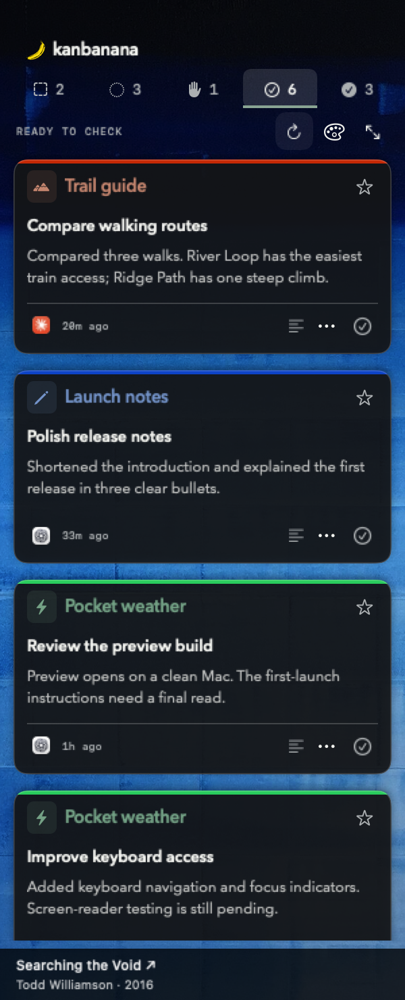
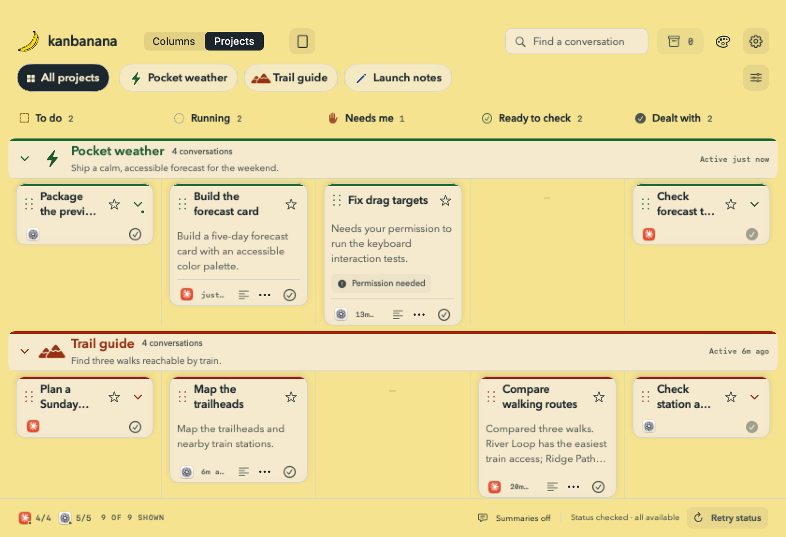

<p align="left"></p>

# kanbanana

**Keep up with your agents in one little Mac window.**

Several conversations running in Claude Code and Codex. A few have finished. One needs an answer. You’ve forgotten what you asked the others to do.

kanbanana puts those conversations on one board. See what needs you, read a short reminder, and jump back into the right app. It lives in your menu bar, with a narrow **Focus** window that fits beside your work.

[Watch the 56-second walkthrough](docs/media/kanbanana-demo.mp4) · [Build it locally](#get-started) · [Compatibility](docs/COMPATIBILITY.md) · [Privacy](PRIVACY.md)



*Screenshots and demo use fictional conversations.*

**macOS · Apple Silicon · early beta.** Source builds are available now. A signed, notarized download is being prepared; there is **no public app download yet**. [Releases](https://github.com/laurenceholt/kanbanana/releases)

## A small place to pick up the thread

- **See what came back.** Ready to check shows the agent’s latest report; Needs me highlights a detected question or interruption. Other states remind you of your latest request.
- **Keep your next move.** Star a priority, mark a round Dealt with, or move it to To do with an optional reminder.
- **Think in projects.** Group conversations across both apps and multiple folders. Add a project goal. Your manual assignments stay put.
- **Remember the conversation.** Expand the request history to retrace what you asked, one request at a time.
- **Use the space you have.** Focus is a thin strip; Projects adds horizontal lanes; Columns puts everything on one board.

kanbanana monitors and organizes existing conversations. Start work, reply and review the actual output in Claude or Codex. Clicking a card opens its native conversation.

## Get started

You need an **Apple Silicon Mac**, **macOS 14+**, and **Swift 6+** (Xcode 16 or newer, or its command line tools). At least one supported provider is needed for live monitoring. No paid Apple Developer membership or API key is needed for a local build.

```zsh
# If Apple's command line tools are not installed:
xcode-select --install
```

After the tools finish installing:

```zsh
git clone https://github.com/laurenceholt/kanbanana.git
cd kanbanana
swift --version
zsh scripts/build.zsh
open dist/kanbanana.app
```

The build downloads a pinned, checksum-verified Python runtime and bundles it inside the app. You don’t need a separate Python installation to run it. Drag the resulting `dist/kanbanana.app` into Applications if you want to keep it there. Quit an existing copy before replacing it.

**Prefer to ask your coding agent?**

> Clone https://github.com/laurenceholt/kanbanana. Read AGENTS.md and README.md, verify the macOS and Swift requirements, run the Swift and Python tests, then build with `zsh scripts/build.zsh` and open `dist/kanbanana.app`. Preserve any existing kanbanana data. Do not change provider permissions or read my API key.

### First launch

1. Choose which providers to monitor. kanbanana imports locally available conversations active in the last two weeks.
2. Open **Focus** to work through Ready to check, or **Projects** to work project by project.
3. Optionally enable cloud summaries in Settings. Until then, cards show local excerpts.

The banana and counts in the menu bar reopen the window. Closing the window keeps monitoring running; **Settings → Quit** stops the app. Double-click the app to restart.

## Supported conversations

| Provider | Supported now |
| --- | --- |
| Claude Desktop | The **Code** section, using locally available session records. Chat and Cowork are outside this beta’s scope. |
| Codex Desktop | Locally stored top-level conversations, including local tasks outside saved projects and scheduled runs. |

**What about terminal users?** Standalone Claude Code CLI sessions are not discovered: the Claude reader needs Desktop Code session metadata. The Codex reader includes local CLI records when they use the supported database/history format, but cards open Codex Desktop, not a terminal. A terminal-only workflow is not end-to-end validated or a supported launch promise.

**A task running on your Mac can still have cloud-backed history.** Those newer Codex conversations are not currently captured by the local-file reader. Remote/SSH/cloud-only work also has no completeness guarantee. Intel builds are not provided.

These integrations read private local file formats, which can change when the source apps update. The macOS 14 minimum is a build target; physical testing is more limited than CI coverage. [Exact evidence, versions and limitations →](docs/COMPATIBILITY.md)

## Three views, one board

**Focus** shows one status as a flat list. **Projects** groups cards into horizontal lanes. **Columns** mixes projects within each status, with optional temporary project stacks. Focus’s expand arrows open Projects.



| State | What it means |
| --- | --- |
| To do | You want another round later. Only you put cards here; each can have a reminder note. |
| Running | The source has recent execution evidence, including tracked background tasks. |
| Needs me | A detected question, required approval, error or interruption. Some native permission waits are not visible to the reader. |
| Ready to check | The agent appears to have delivered. It does not certify correctness, tests or a Git push. |
| Dealt with | Your acknowledgement of this round. A new request reactivates the card. |
| Status unavailable | The app cannot establish the current state. Retry rereads the source; your notes and assignments are preserved. |

Quiet cards move to the parking lot after seven days; To do reminders stay. The full board’s archive-box button lets you find and restore parked cards. A temporary read failure never triggers automatic parking.

## Local by default

There is no kanbanana account, telemetry service or developer-operated backend. Native source records are read-only. Project goals, To do notes and assignments belong to kanbanana and never modify Claude or Codex.

**Optional OpenAI summaries:** save your own API key in Settings, then explicitly enable summaries. Saving a key alone does not enable them. Selected requests and latest agent reports go directly to OpenAI, billed to your API account. A ChatGPT subscription does not include API credit. Keys stay in macOS Keychain; project and To do notes are not sent.

You can choose the model, exclude projects and set a daily attempt limit. The default is 100 attempts; each can retry once. This is an attempt cap, not a dollar budget. [Full privacy, retention and cost controls →](PRIVACY.md)

Your board lives in `~/Library/Application Support/Agent Kanban/` (the historical name preserves existing installations). Settings includes **Export board**, **Restore**, **Open data folder** and **Diagnostics**. Seven rotating backups are kept locally. Board exports contain private text; use sanitized Diagnostics when reporting a problem. [Recovery and troubleshooting →](docs/TROUBLESHOOTING.md)

## Make it yours

Choose Classic, Night, Brutalist or Art details. Project symbols and saturated color strips help you distinguish cards. Art details rotates through 19 licensed contemporary works, with a small artist credit and source link. All images are bundled locally. [Artwork and credits →](Resources/Art/README.md)

## Build, test and contribute

The app has three Swift targets: pure board rules in **Core**, persistence and integrations in **Services**, and the **macOS interface**. The Python reader has separate adapters, parsers and worker supervision. [Architecture →](docs/ARCHITECTURE.md)

```zsh
swift test -Xswiftc -warnings-as-errors
zsh scripts/fetch-runtime.zsh
.build/runtime/python/bin/python3 -I -B -m unittest discover -s tests -v
zsh scripts/build.zsh
zsh scripts/audit.zsh
```

To explore without connecting to your conversations:

```zsh
swift run AgentKanban --demo
```

Demo mode uses fictional data, temporary storage/preferences and disabled monitoring, Keychain and summary services. Changes are discarded when you quit. Generate screenshots with `zsh scripts/previews.zsh`, or the video with `zsh scripts/demo.zsh` (requires FFmpeg). [Demo production notes →](docs/DEMO.md)

[Contributing](CONTRIBUTING.md) · [Release checklist](docs/RELEASING.md) · [Launch checklist](docs/LAUNCH.md) · [Changelog](CHANGELOG.md) · [Security reports](SECURITY.md)

Independently developed; not affiliated with Anthropic or OpenAI. Source code and the generated banana mark are MIT licensed. Artwork and bundled runtime components retain their [separate licenses](THIRD_PARTY_NOTICES.md).
