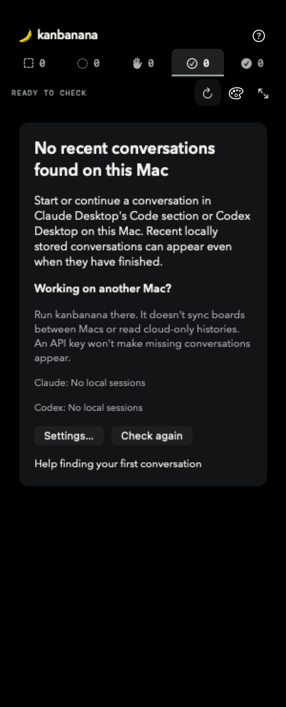
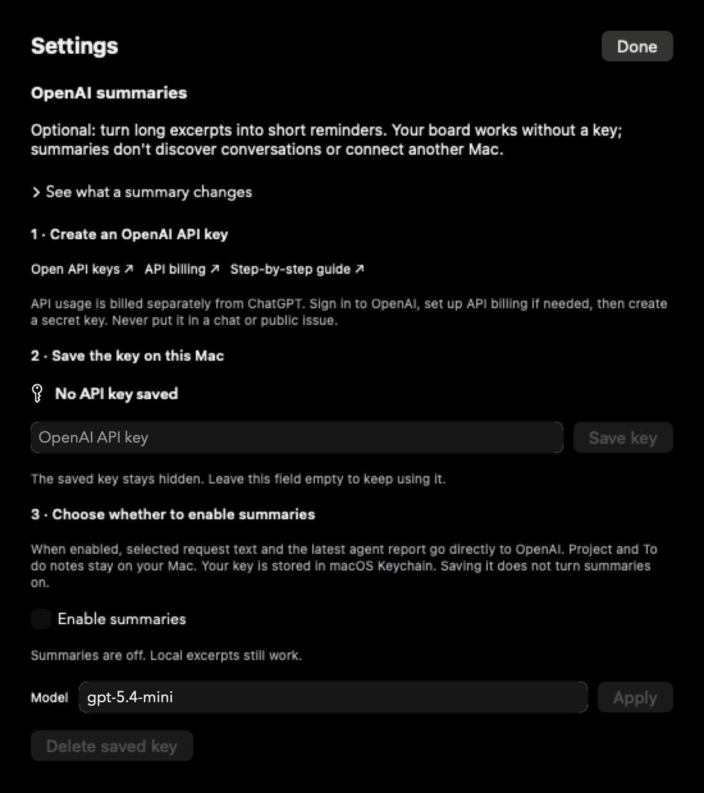

# Using kanbanana

A small window for keeping up with your Claude Code and Codex conversations. Start work and reply in those apps; use kanbanana to see what's happening and remember your next move.

[Your first conversation](#your-first-conversation) · [The board](#using-the-board) · [Appearance](#appearance) · [AI summaries](#optional-ai-summaries) · [Missing conversations](#missing-conversations)

[Watch the one-minute overview](media/kanbanana-demo.mp4). The video and screenshots use fictional conversations. Your first board may be empty, and that's okay.

## Your first conversation

**Use kanbanana on the Mac where your conversations are stored.** If all your work runs on a Mac Studio, installing kanbanana on your MacBook Air won't bring that work across. There is no cross-Mac board sync or cloud-history connection. An API key is unrelated to discovery.

1. Open kanbanana. On the welcome screen, choose **Claude Desktop Code**, **Codex Desktop**, or both, then click **Look for conversations**.
2. Give the local scan a moment. The initial import looks for supported conversations active in the last two weeks, including finished ones. A job doesn't have to be running now.
3. If the board is empty, open Claude Desktop's **Code** section or Codex Desktop **on this Mac**. Start or continue a locally stored conversation, then return to kanbanana. It checks automatically; **Check again** requests another scan.
4. If no card appears, read the source status on the empty board and follow [Missing conversations](#missing-conversations). Starting a task on this Mac does not guarantee that its history is local: newer cloud-backed Codex histories are not supported.

You can change the background or read Help while the board is empty. You do **not** need an API key to see cards, use projects, or track status.

Once a card appears, clicking its conversation title opens the conversation in its original app. kanbanana doesn't start jobs or send replies for you.

## Using the board

### Choose a view

- **Focus:** a narrow strip. Click a status icon/count to show its cards. The expanding arrows open Projects. The **?** menu opens Help and Settings.
- **Projects:** horizontal lanes group conversations by project, with the most recently active project first. Use the project chips to focus on one project; **All projects** also clears search.
- **Columns:** conversations sit under status headings, with project colors and symbols. The stack control groups cards from a project temporarily; expand a stack to see its individual conversations.

### What the states mean

| State | What to do |
| --- | --- |
| **To do** | A reminder that you want another round. You move a card here yourself and can add a note. Starting the next request happens in Claude or Codex. |
| **Running** | The source records indicate work is in progress. |
| **Needs me** | A detected question, required input or interruption. Open the conversation to respond. Some native permission prompts cannot be detected. |
| **Ready to check** | The agent appears to have delivered a result. Open the conversation and check it. This doesn't certify correctness, passing tests, or a Git push. |
| **Dealt with** | You've handled this round. A new request brings the card back automatically. |
| **Status unavailable** | kanbanana cannot establish a current status. Retry rereads the source; it doesn't erase your notes or assignments. |

An empty **Ready to check** column does not mean no conversations were found. Check the other counts. An empty board after filtering offers **Clear filters**. If everything is parked, it offers **Open parking lot**.

### Keep track of your next move

- Click a card's **star** to keep it above other cards in lists.
- Click the **Dealt with** button at the bottom right after reviewing a result. To do and Dealt with cards collapse; expand them to read more.
- Drag a card to **To do** to add an optional next-step note. Delete that note when it is no longer needed; the project goal is separate.
- Use the card's history control to see previous requests. Each request stays separate. Ready to check and Needs me show the latest agent report; other states remind you of your request.

### Organize projects

Open Projects view, then click the sliders button beside the project chips (**Manage projects**). Add or rename a project, write its near-term goal, and choose a symbol and color.

Drag a card onto a project chip or use its project assignment menu. A project can contain conversations from different folders and both apps. Each conversation remains its own card. Your manual assignment takes precedence over later automatic grouping.

### Park and restore

In the full board, the **archive-box** button opens the parking lot. Parked conversations stay recoverable; use their restore action to bring them back. Quiet cards normally park after seven days; To do reminders stay on the board. A temporary source read failure does not itself park a card.

## Appearance

Click the **palette** button in either Focus or the full board.

1. Choose **Classic**, **Night**, **Brutalist**, or **Art details**.
2. For Classic, open **Classic colors → Background** to choose a color. **Cards & project headers** changes the paper color. Those color choices are visible in Classic; Night and the other themes have their own styling.
3. For Art details, choose **Art library…** to pick a work, or **Next artwork** to move on. Art rotates hourly. Click the credit at the bottom of the window for the source; the library includes artist and license links.

Your appearance choices are remembered on this Mac. No API key or image-generation subscription is needed; the artwork is bundled with the app.

## Optional AI summaries

Without AI, cards use local excerpts. With AI, kanbanana asks OpenAI to turn selected requests or agent reports into concise reminders.

| Fictional agent report | Example summary |
| --- | --- |
| “I've finished updating the forecast card. I added keyboard controls, fixed the drag targets, and ran the interaction tests…” | “Fixed drag targets and keyboard controls; interaction tests pass.” |

Summaries help you scan the board. They don't run your agents, verify the work, find missing conversations or sync another Mac.

### Set up a key

1. In Focus, choose **? → Set up summaries…**. In the full board, use that menu or the **gear** button.
2. Click **Open API keys** and sign in to the [OpenAI API platform](https://platform.openai.com/api-keys). Choose your API project and create a new secret key. If API billing is not set up, use the **API billing** link. This is separate from a ChatGPT subscription. OpenAI's [official quickstart](https://developers.openai.com/api/docs/quickstart) explains API keys and billing.
3. Copy the complete secret key, return to kanbanana, paste it into **OpenAI API key**, and click **Save key**. Never paste it into a conversation or public issue.
4. Look for **API key saved in macOS Keychain**. The input clears deliberately: the stored key stays hidden. You do not need to paste it again every time you open Settings. Saving confirms storage, not that OpenAI has accepted a request yet.
5. Read the privacy explanation, choose your daily summary limit and any excluded projects, then turn on **Enable summaries**. Saving the key alone leaves summaries off.
6. Check the summary status below the controls. A real request establishes whether the key, billing and selected model work. If something fails, resolve the reported problem and use **Retry summaries**.

**Costs and privacy:** selected request text and the latest agent report go directly from your Mac to OpenAI. Project goals and To do notes are not sent. The default daily limit is 100 summary attempts; each can make up to two API calls. This is an attempt limit, not a dollar cap. Cost depends on your model and text length. Use the API platform's billing controls and usage reports as well.

Keep the default model unless you have a reason to change it. If you enter another model, click **Apply** and confirm that your API project has access. You can turn summaries off or delete the saved key at any time. Existing cached summaries may remain visible. Read [Privacy](../PRIVACY.md) for details and OpenAI data-handling links.

## Missing conversations

| What you see | What to check |
| --- | --- |
| Empty board on a new Mac | Are the conversations stored on a different Mac? Run kanbanana there. Boards do not sync. |
| No local sessions | Use Claude Desktop **Code**, or a supported locally stored Codex conversation. Claude Chat/Cowork and standalone Claude Code CLI sessions are not discovered. |
| A Codex task runs on this Mac but never appears | Its history may be cloud-backed. That is not currently supported, even when the execution location is this Mac. Moving it into a project does not make its history local. |
| Monitoring off | Open Settings and enable at least one integration. |
| Not installed | Install/open the desktop app you intend to use on this Mac. Terminal-only workflows are not fully supported; see [Compatibility](COMPATIBILITY.md). |
| Access denied, unsupported format or updates paused | Open Settings for the source status. Check file access and whether a provider update changed its format. Use Retry after resolving the issue; see [Troubleshooting](TROUBLESHOOTING.md). |
| Older work is missing | Check the parking lot. Settings also offers **Find older conversations** to scan beyond the initial two-week window. |
| Some cards are missing | Clear the project/search filters and check all status counts and the parking lot. |
| The key field is empty | Read the Keychain status. A saved key is intentionally hidden. Adding a key does not affect discovery. |

## Closing, updating and getting help

Drag the **banana or kanbanana title** to move the window. Drag a window edge or corner to resize it; Focus and the full board remember their sizes separately.

Closing the window keeps monitoring running. Click the banana/counts in the macOS menu bar to reopen it. **Settings → Quit** stops the app; open kanbanana again to restart.

Updates come from [GitHub Releases](https://github.com/laurenceholt/kanbanana/releases); there is no automatic updater. Quit kanbanana before replacing the app. Keep `~/Library/Application Support/Agent Kanban/` so your board, project notes and preferences survive.

Settings offers **Export board**, **Restore**, and **Diagnostics**. Exported boards contain private text; keep them private. When reporting a problem, include the app, provider and macOS versions and sanitized diagnostics rather than conversation histories or keys. See [recovery instructions](TROUBLESHOOTING.md).
